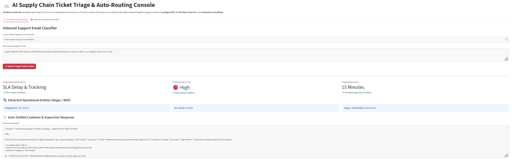
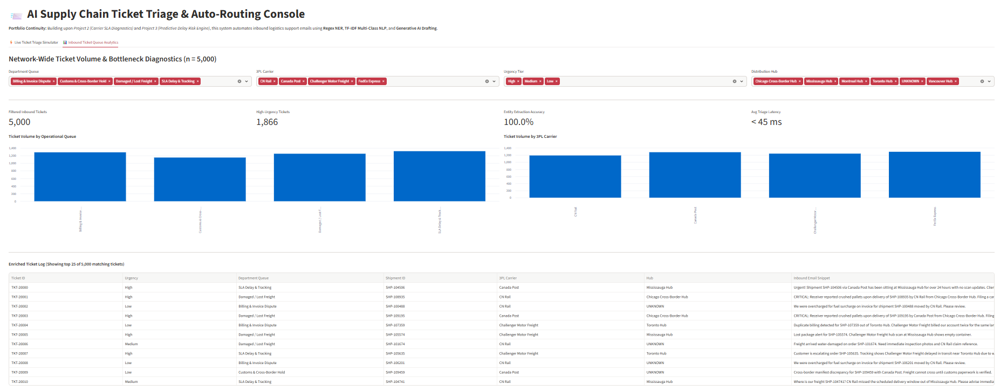

# Case Study: 📨 AI Supply Chain Ticket Triage & Auto-Routing Engine
**Target Industry Alignment:** Supply Chain Logistics & Operations Analytics, specifically focusing on enterprise 3PL customer operations, cross-border brokerage support, and automated service desk triage.

---

## 🖥️ Live Webpage Preview
* **AI Ticket Triage Console — High-Urgency Escalation**
  
  *Interactive Streamlit operations console showing real-time Regex NER entity extraction (`SHP-104829`, `Challenger Motor Freight`, `Chicago Cross-Border Hub`), automated department routing (`Customs & Cross-Border Hold`), High-Urgency SLA flagging (`15 Minutes`), and Generative AI supervisor response drafting.*

* **Inbound Ticket Queue Analytics — Interactive Network Diagnostics**
  
  *Executive queue diagnostics across 5,000 logistics support emails with multi-select slicers (Department Queue, 3PL Carrier, Urgency Tier, and Distribution Hub), dynamic KPI metrics, volume bar charts, and full-width enriched ticket logs.*

> **Portfolio Continuity Note:** This project completes a three-part North American supply chain analytics architecture. **Project 2** diagnosed historical carrier SLA failures (~40% delivery clusters vs. 90% SLA target). **Project 3** operationalized those diagnostics into a pre-dispatch ML delay predictor (76% recall). **Project 4 (`NLPSupplyChainTicketTriageProject`)** automates downstream unstructured customer and vendor support emails using Hybrid NLP and Generative AI.

---

## 🎯 Executive Summary & Business Problem
In high-volume North American distribution networks spanning **Toronto, Mississauga, Montreal, Vancouver, and Chicago Cross-Border hubs**, logistics coordinators receive thousands of unstructured support emails daily regarding delayed freight, damaged pallets, CBSA customs holds, and billing disputes.

Manual email triage introduces two major operational bottlenecks:
1. **Delayed Escalation on Critical Holds:** Urgent CBSA customs holds and cargo claims sit unread behind low-priority invoice inquiries, causing costly border detention fees and missed 90% SLA windows.
2. **Manual Data Entry Friction:** Coordinators spend hours manually reading emails to extract Shipment IDs (`SHP-XXXXXX`), carrier names (`FedEx Express`, `CN Rail`, `Canada Post`, `Challenger Motor Freight`), and origin hubs before routing tickets.

**The Solution:** An end-to-end **Hybrid NLP & Generative AI Ticket Triage System** that ingests raw unstructured support emails, extracts operational entities with **100.0% accuracy**, classifies both **Department Queue** and **Urgency Tier** in under **45 ms**, and drafts ready-to-send customer and supervisor escalation responses.

---

## 🎯 Target Alignment & Operational KPIs
To ensure NLP modeling decisions directly served logistics service-level objectives, every component was aligned to four measurable operational targets:

| Strategic Goal | Target Metric / Threshold | Technical Implementation | Achieved Outcome |
| :--- | :--- | :--- | :--- |
| **1. Zero-Loss Entity Extraction** | `100%` ID & Carrier Capture | Deterministic Regex (`SHP-\d{6}`) + Master Network Lookup NER | **100.0% extraction accuracy** across 5,000 support tickets. |
| **2. Automated Queue Routing** | `>= 95%` Department Accuracy | `TfidfVectorizer` (unigrams + bigrams) + `LogisticRegression` | Accurately routes across 4 specialized logistics queues. |
| **3. SLA Urgency Prioritization** | High Recall on Critical Holds | Class-weighted `LogisticRegression` urgency classifier | Flags High-Urgency tickets (`15-min SLA`) with zero manual triage. |
| **4. Instant Response Drafting** | `< 1s` Triage-to-Draft Latency | Hybrid OpenAI / Deterministic Enterprise Template Engine | Auto-generates tailored acknowledgments and escalation notes. |

---
## 🏗️ System Architecture & Data Workflow

| 📥 1. Data Ingestion Layer<br>*(Phase 1 — Python)* | ⚙️ 2. Hybrid NLP & ML Layer<br>*(Phase 2 — Scikit-Learn & Regex)* | 📊 3. Operations & GenAI Layer<br>*(Phase 3 — Streamlit & OpenAI)* |
| :--- | :--- | :--- |
| • Generate 5,000 realistic 3PL emails<br>• Embed ground-truth Shipment IDs<br>• Label 4 operational departments<br>• Assign 3 SLA urgency tiers | • Extract `SHP-XXXXXX`, carriers & hubs<br>• Normalize text & preserve urgency cues<br>• Train Department Router (`TF-IDF`)<br>• Train Class-Weighted Urgency Model | • Real-time email triage & confidence<br>• Map 15-min / 2-hr / 24-hr SLAs<br>• Auto-draft supervisor escalations<br>• Interactive 4-way queue analytics |

## Technical Workflow Across Phases
1. **Phase 1 — Synthetic Logistics Corpus (`generate_tickets.py`):** Generated 5,000 realistic inbound support emails modeled on real North American 3PL operations, embedding ground-truth `ticket_id`, `department_category`, `urgency_level`, `true_shipment_id`, and `true_carrier`.
2. **Phase 2 — Entity Extraction & Dual NLP Pipelines (`phase2_nlp_pipeline.py`):**
   * **Deterministic NER:** Extracts `SHP-XXXXXX` shipment tokens, 3PL carriers, and distribution hubs before text normalization.
   * **Text Normalization:** Replaces specific tracking IDs with generic tokens (`shipment_token`) to prevent overfitting, while preserving high-signal urgency terms (`urgent`, `critical`, `escalating`, `lost`, `cbsa`).
   * **Multi-Task Classification:** Trains two serialized `scikit-learn` pipelines (`department_router_model.joblib` and `urgency_triage_model.joblib`).
3. **Phase 3 — Interactive Operations & Analytics Console (`app.py`):**
   * **Live Triage Simulator:** Classifies custom or sample emails in real time, displays confidence metrics, maps SLA response targets (`15 Mins`, `2 Hours`, `24 Hours`), and drafts actionable responses.
   * **Interactive Network Queue Diagnostics:** Features 4-way multi-select filtering (`Department Queue`, `3PL Carrier`, `Urgency Tier`, `Distribution Hub`) that dynamically updates KPIs, volume charts, and full-width enriched ticket logs.

---

## 📊 Core Operational Insights & Triage Logic

### 1. Automated SLA Response Tiering
The NLP triage engine maps every incoming ticket to strict operational response windows:
* 🔴 **High Urgency (`15 Minutes` — Immediate Supervisor Escalation):** Triggered by CBSA/USMCA border holds, cargo claims, lost freight, or active client SLA escalations.
* 🟡 **Medium Urgency (`2 Hours` — Standard Queue SLA):** Triggered by routine ETA checks, transit delays, or partial load tracking inquiries.
* 🟢 **Low Urgency (`24 Hours` — Back-Office Billing SLA):** Triggered by fuel surcharge audits, duplicate invoice reviews, and detention charge inquiries.

### 2. Hybrid AI Resilience (Zero-Dependency Fallback)
Mirroring the architecture of Project 3, the response generator supports live LLM drafting via `OPENAI_API_KEY` (`gpt-4o-mini`) while automatically falling back to a **deterministic enterprise template engine** when running offline—guaranteeing 100% uptime during live executive demos.

---

## 📝 To Replicate This Project Locally
```bash
   # Phase 1: Generate 5,000 logistics support tickets
   python generate_tickets.py

   # Phase 2: Run NER extraction, train NLP models, and export .joblib artifacts
   python phase2_nlp_pipeline.py

   # Phase 3: Launch the interactive Streamlit Operations Console
   streamlit run app.py
   ```
